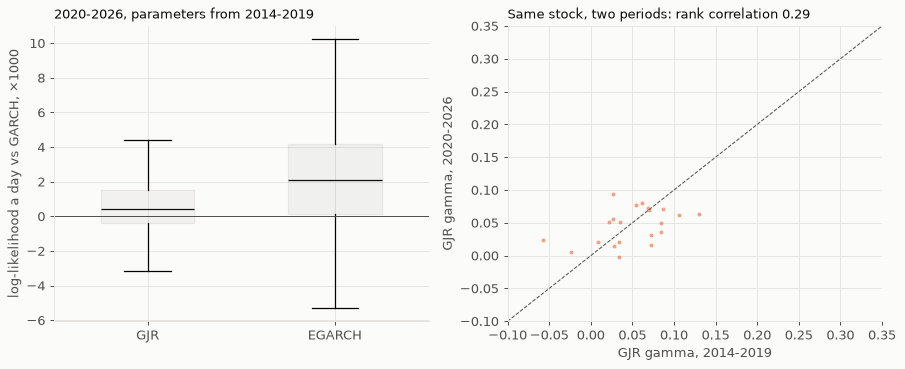
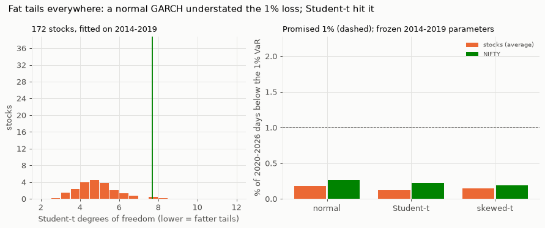
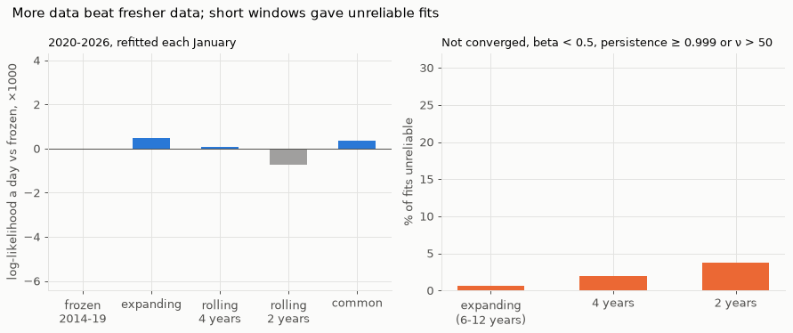
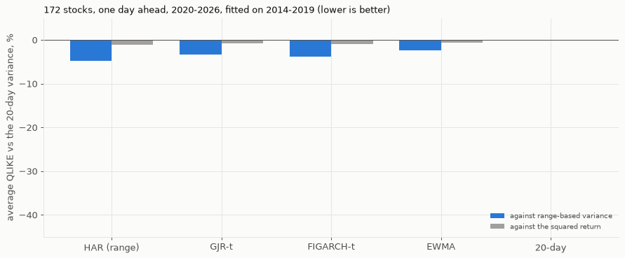
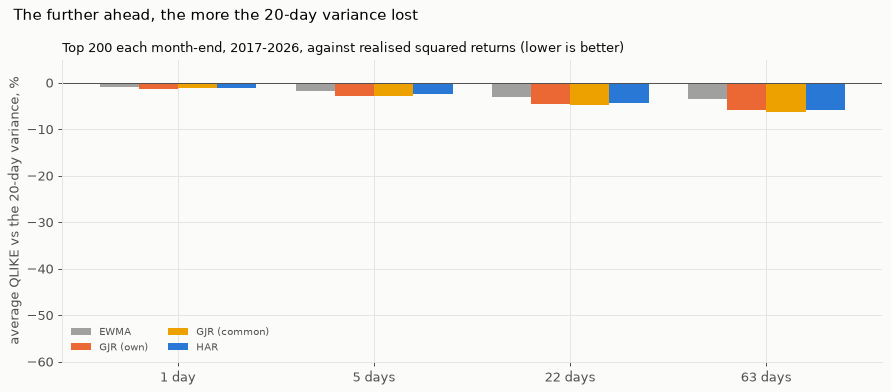
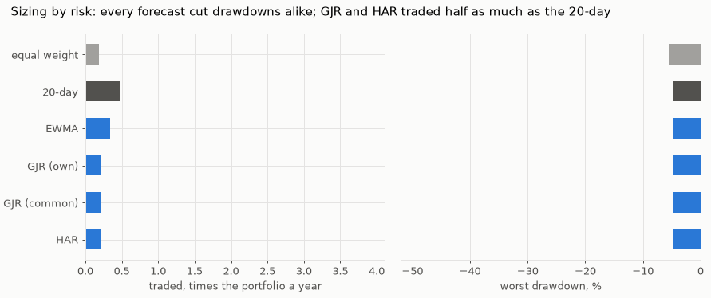
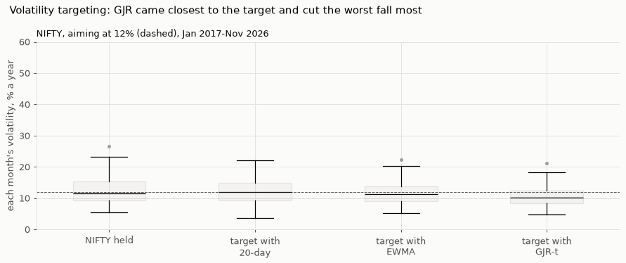
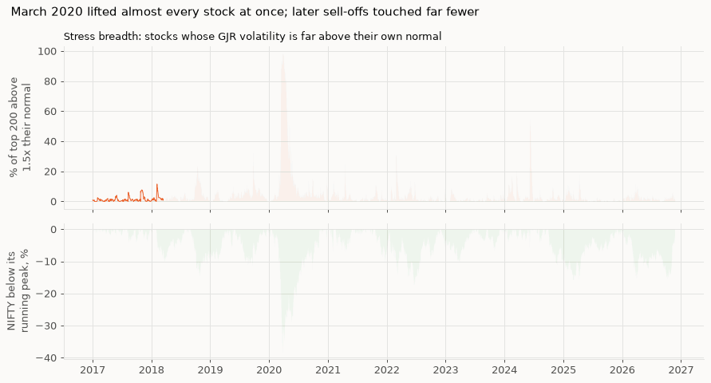
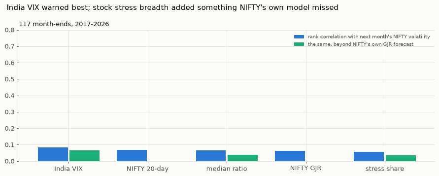

# GARCH Volatility

[](https://github.com/Dhirajdas18/garch-volatility/actions/workflows/ci.yml)
[](https://dhirajdas18.github.io/garch-volatility/)

Volatility forecasting for NSE stocks beyond plain GARCH(1,1): asymmetric models, fat-tailed
shocks, HAR and long-memory models, and forecasts from one day to three months, each tested against
the plain 20-day standard deviation. The findings use a point-in-time universe of the 200
most-traded stocks from a local NSE bhavcopy archive (from 2013), delisted ones included.

**Live GARCH lab: [dhirajdas18.github.io/garch-volatility](https://dhirajdas18.github.io/garch-volatility/)**,
pick a stock, a model and a horizon and see conditional volatility, the forecast to 63 days, the
news-impact curve and one-day value at risk, computed in your browser; refitted every week from
fresh data by GitHub Actions.

## Features

- [x] Asymmetric GARCH (GJR, EGARCH) across 172 stocks, fitted on 2014–2019 and scored on 2020–2026
- [x] Error distributions: normal, Student-t, skewed-t, scored by log-likelihood and VaR breaches
- [x] Estimation in practice: parameter stability, refit schedules, unreliable fits, common parameters
- [x] HAR on range-based volatility and long-memory FIGARCH against GJR, EWMA and the 20-day variance
- [x] Forecasts from 1 day to 3 months across the point-in-time top 200 (464 stocks) against the 20-day variance
- [x] Sizing and volatility targeting with GARCH against the 20-day standard deviation, after costs
- [x] Market-wide stress: stock stress breadth against India VIX and NIFTY's own forecasts

## Findings

### 1. Bad news raised volatility more than good news; strongly for NIFTY, weakly for single stocks

<a href="docs/img/asymmetry_news.png"><picture><source media="(prefers-reduced-motion: reduce)" srcset="docs/img/asymmetry_news.png"></picture></a>

<a href="docs/img/asymmetry_oos.png"><picture><source media="(prefers-reduced-motion: reduce)" srcset="docs/img/asymmetry_oos.png"></picture></a>

GJR adds a term that only bad days (returns below the mean) feed into tomorrow's variance; EGARCH
models the log of the variance with a separate response to the sign of the shock. Each stock in the
universe's top 200 on 31 December 2019 with returns on 95% of 2014–2019 days (172 stocks) is fitted on
2014–2019 with Student-t shocks, then scored on 2020–2026 with every parameter frozen by the
log-likelihood of each day's return given the variance known the day before (median 1,704 days).
NIFTY is fitted the same way. Archive prices, no dividends.

- **Bad news counted for more in most stocks, but rarely clearly.** GJR's bad-news term was positive
  for 84% of stocks (median 0.040 against a symmetric term of 0.069), but its t-statistic passed 2 for
  only 13%. EGARCH's asymmetry pointed the same way for 81%, past t −2 for 23%.
- **For NIFTY it was almost all bad news.** GJR put NIFTY's symmetric term at 0.000 and its bad-news
  term at 0.140 (t 3.7): a 4% fall lifted tomorrow's volatility to 26.7% a year, a 4% rise left it at 12.6%.
  Refitted on 2020–2026 the bad-news term was 0.125.
- **On unseen years, asymmetry helped a little.** Against plain GARCH, EGARCH scored better for 75% of
  stocks (median +0.0021 log-likelihood a day) and GJR for 63% (+0.0004).
  For NIFTY, GJR gained +0.0094 a day while EGARCH lost 0.0053.
- **A stock's own asymmetry barely repeated.** The rank correlation between each stock's GJR bad-news
  term in 2014–2019 and in 2020–2026 was 0.29; in-sample, AIC preferred GJR for 42% of stocks and BIC
  for 14%.
### 2. Every stock had fat tails; Student-t shocks brought the average 1% breach rate to target

<a href="docs/img/distributions.png"><picture><source media="(prefers-reduced-motion: reduce)" srcset="docs/img/distributions.png"></picture></a>

The same 172 stocks, windows and frozen-parameter scoring as finding 1, with GJR and three shock
distributions: normal, Student-t (fatter tails, with degrees of freedom ν; the lower, the fatter) and
skewed-t (also lopsided, with λ). Each is scored on 2020–2026 by the log-likelihood of each day's return
and by how often the return fell below the model's one-day 1% and 5% value at risk; Kupiec's test asks
whether each stock's breach rate is consistent with the promise.

- **Fat tails everywhere.** Student-t's degrees of freedom had a median of 4.8 (10th–90th percentile
  3.6–6.1); NIFTY's was 7.7. On unseen years Student-t beat the normal for 100% of stocks (median
  +0.064 log-likelihood a day).
- **The normal understated the 1% loss.** Its 1% value at risk was breached on 1.50% of days on average
  (Kupiec rejected 51% of stocks), against 0.97% for Student-t. At 5% it erred the other way (4.07%): a
  normal is too wide in the middle and too thin in the tails.
- **Skew helped NIFTY, not stocks.** Skewed-t matched Student-t for stocks (better for 48%, median
  −0.00001 a day; λ was positive for 90%, a slightly longer right tail). For NIFTY, λ was −0.079 and
  its 1% breach rate fell from 1.82% to 1.58%, still too often (Kupiec rejects both). For stocks,
  skewed-t breached the 1% level more (1.18%) but the 5% level closer to target (5.07% against 4.53%).
- **The distribution changes the tails, not the volatility.** Student-t and normal fits gave
  volatility paths with a median correlation of 0.982 and the same level (ratio 1.002).
- **Six-year-old parameters were still off for many stocks.** Even with Student-t, Kupiec rejected the
  1% breach rate for 27% of stocks (5% would be expected by chance); finding 3 looks at refitting.
### 3. More data beat fresher data; common parameters were the most reliable

<a href="docs/img/refit.png"><picture><source media="(prefers-reduced-motion: reduce)" srcset="docs/img/refit.png"></picture></a>

The same 172 stocks with GJR and Student-t shocks. Before each test year 2020–2026 the parameters are
set five ways from data before 1 January: a single 2014–2019 fit kept frozen; a yearly refit on
everything since 2014 (expanding); yearly refits on the last 4 or 2 years; and common parameters (the
cross-stock median of each 4-year fit's α, γ, β and ν, with each stock's ω set so its long-run variance
equals its own 4-year variance). Each is scored through the year with frozen parameters (1,193
stock-years). A fit is called unreliable if it didn't converge, put β below 0.5, put persistence at or
above 0.999, or put ν above 50.

- **More data beat fresher data.** Refitting each year on everything since 2014 scored +0.0036
  log-likelihood a day above the frozen fit (better for 77% of stocks) and cut Kupiec rejections of the
  1% value at risk from 27% of stocks to 15%. Four-year windows gained +0.0005; two-year windows lost
  0.0062.
- **Short windows gave unreliable fits.** 30% of two-year fits were unreliable (24% put β below 0.5),
  16% of four-year fits and 6% of expanding ones; none failed to converge. Persistence moved a median
  0.071 a year with two-year windows, 0.024 with four and 0.009 with expanding.
- **Common parameters were the most reliable.** One shared set of α, γ, β and ν, scaled to each
  stock's own variance, scored +0.0027 (better than frozen for 57%) with the fewest Kupiec rejections
  (12%) and a 1.02% breach rate.
### 4. HAR on daily ranges forecast tomorrow best; the 20-day variance was the worst of five

<a href="docs/img/har.png"><picture><source media="(prefers-reduced-motion: reduce)" srcset="docs/img/har.png"></picture></a>

Without intraday prices, each day's "realised" variance is estimated from its open, high, low and close
(Garman-Klass) plus the squared overnight gap. HAR forecasts tomorrow's value from today's, the last
week's and the last month's averages (in logs, by least squares). It is compared with GJR and FIGARCH
(a long-memory GARCH, standing in for a component model, which arch lacks), both with Student-t shocks,
EWMA (λ 0.94) and the 20-day variance of returns. All are fitted on 2013–2019 and frozen; the same 172
stocks are forecast one day ahead over 2020–2026 (median 1,704 days) and scored by QLIKE, the standard
volatility loss, against the range-based variance and, because HAR is fitted to that very proxy, also
against the squared return.

- **HAR forecast best.** Against the range-based variance its loss was 38% below the 20-day variance's,
  and it was the best model for 97% of stocks. Against squared returns, where it has no home advantage,
  it was still 9% better and best for 81%.
- **GARCH-family models came next.** FIGARCH was 31% better than the 20-day variance (8% on squared
  returns), GJR 28% (7%), EWMA 20% (5%).
- **The 20-day variance came last.** Every other model beat it for 98–100% of stocks, on either target.
- **HAR spread its weight evenly.** Median weights on the log of the last day, week and month: 0.23,
  0.23 and 0.22.
- **The range proxy runs high.** Over 2020–2026 it averaged 1.17 times the squared return (median stock;
  1.05–1.37 across stocks), so every model's average forecast sat below it (ratios 0.85–0.92), and it
  favours HAR, which is fitted to it; the squared-return ranking is the fairer one.
### 5. Across 464 stocks and four horizons, GJR with common parameters halved the 20-day variance's loss at three months

<a href="docs/img/horizons.png"><picture><source media="(prefers-reduced-motion: reduce)" srcset="docs/img/horizons.png"></picture></a>

At every month-end from January 2017 to October 2026 (118 origins) each stock in that day's top-200
universe, delisted ones included (464 different stocks), gets a forecast of its average daily variance
over the next 1, 5, 22 and 63 trading days. The forecasts: the 20-day variance and EWMA, which assume the
future looks like now; GJR with Student-t shocks fitted on each stock's own history since 2013, or with
common parameters (as in finding 3), both of which drift back toward the long-run level over the
horizon; and HAR fitted for each horizon on range-based daily variance. Parameters are set each January
from earlier data. The target is the realised average squared return over the horizon, which no model
is fitted to; scoring is QLIKE, with Newey-West t-statistics on the monthly differences.

- **Every model beat the 20-day variance at every horizon.** One day ahead the gain was 7–10% (t −4.2 to
  −6.8); at 5 days 15–22%; at 22 days 24–38%; at 63 days 28–52%.
- **The gap grew with the horizon.** The 20-day variance and EWMA assume today's level persists; GJR and
  HAR let it revert. At 63 days GJR with common parameters lost 52% less than the 20-day variance (t −3.8,
  better in 88% of months), GJR with own fits 48% and HAR 47%; EWMA only 28%.
- **Common parameters matched or beat each stock's own fit** at every horizon (−10%, −22%, −38%, −52%
  against −10%, −22%, −37%, −48%), with nothing to estimate per stock but its variance level.
- **HAR sat level with or slightly behind GJR.** In this set-up (yearly refits, 464 stocks, HAR in
  levels on squared returns) HAR was 9% better than the 20-day variance one day ahead against GJR's
  10%, and level or behind at every horizon; finding 4's set-up (frozen 2013–2019 fits, 172 stocks,
  log-HAR) had HAR slightly ahead on squared returns (9% against 7%).
### 6. A better forecast didn't add return; it halved trading in sizing and hit a volatility target more closely

<a href="docs/img/sizing_inverse_vol.png"><picture><source media="(prefers-reduced-motion: reduce)" srcset="docs/img/sizing_inverse_vol.png"></picture></a>

<a href="docs/img/sizing_target.png"><picture><source media="(prefers-reduced-motion: reduce)" srcset="docs/img/sizing_target.png"></picture></a>

Two uses of the forecasts, decided at each month-end from 2017 and held for the month. A: each month's
top-200 universe weighted in proportion to 1 / forecast volatility (the 22-day forecasts of finding 5),
against equal weights, with delivery charges and slippage of 0.17% a side on the weights traded. B: NIFTY
held at exposure 12% ÷ forecast volatility (at most 1.5×), the rest in cash at 6.5%, with GJR-t refitted
each January on NIFTY's own history (finding 1), the 20-day standard deviation and EWMA. No dividends.

- **Sizing by risk lowered risk, whatever the forecast.** Against equal weight (12.4% a year, volatility
  20.8%, worst drawdown −44.8%), every inverse-volatility version had volatility 19.4–19.5% and a worst
  drawdown of −38.7% to −39.6%, with Sharpes of 0.37–0.39 against 0.36.
- **The better forecasts traded half as much.** Weights from the 20-day standard deviation turned over
  3.92 times the portfolio a year, EWMA 2.78, GJR 1.81 and HAR 1.72 (equal weight 1.52); after costs GJR
  made 12.7–12.8% a year against 12.4% with the 20-day.
- **GJR came closest to a volatility target.** Targeting 12%, NIFTY's realised volatility was 11.9% with
  GJR, 13.8% with the 20-day and 13.5% with EWMA (16.3% held); each month's volatility missed 12% by 4.6
  points (root mean square) with GJR against 5.4 and 5.4, and passed 18% in 7% of months against 13% and
  11% (17% held). GJR's forecasts moved least (standard deviation 6.0 points against 8.9 for the
  20-day and 8.3 for EWMA).
- **Targeting cut the worst fall far more than the return.** NIFTY held made 11.6% a year with a
  −38.4% worst drawdown; targeted with GJR, 10.2% with −23.8% (Sharpe 0.35 against 0.37); with the
  20-day, 10.1% and −27.7% (0.31). Exposure above 1× is financed at the flat 6.5% cash rate, which
  slightly flatters targeting.
### 7. Market-wide stress: India VIX warned best; stock breadth added something NIFTY's own GARCH missed

<a href="docs/img/regime_timeline.png"><picture><source media="(prefers-reduced-motion: reduce)" srcset="docs/img/regime_timeline.png"></picture></a>

<a href="docs/img/regime_warning.png"><picture><source media="(prefers-reduced-motion: reduce)" srcset="docs/img/regime_warning.png"></picture></a>

Each January every stock gets GJR with Student-t shocks and common parameters (finding 3), set to its own
long-run variance. Each day, a stock's ratio is its one-day GJR volatility divided by that long-run level;
stress breadth is the share of that day's top-200 universe with a ratio above 1.5, and the median ratio
summarises the whole list. At each of 117 month-ends from January 2017 these, India VIX, and NIFTY's own
GJR and 20-day forecasts are compared, by rank correlation, with what NIFTY did over the next 22 trading
days.

- **March 2020 hit almost every stock at once.** On 26 March 2020, 98.5% of the top 200 were above 1.5
  times their normal volatility (median day: 1.5%). The 2024 election-result week peaked at 54.5% (6 June);
  the early-2025 sell-off at 11.5% (28 January).
- **India VIX warned best.** Its rank correlation with next month's NIFTY volatility was 0.67, against
  0.55 for NIFTY's 20-day volatility, 0.53 for the median ratio, 0.51 for NIFTY's GJR and 0.47 for the
  stress share.
- **Breadth added something NIFTY's own model missed, but little beyond VIX.** After removing what
  NIFTY's GJR forecast already said, the median ratio still ranked next month's volatility at 0.31 and
  the stress share at 0.28 (India VIX 0.52); after removing India VIX, only 0.14 and 0.16.
- **Stress signalled risk, not direction.** Split by the median ratio into thirds, NIFTY's next 22 days
  after the most stressed month-ends had 18.5% volatility and a −4.9% average worst fall, against 10.5%
  and −3.1% after the calmest, but returned +1.5% against +0.8% (thirds cut on the whole period).

## Quick start

```bash
uv sync
uv run python scripts/fetch_data.py         # Yahoo Finance -> data/prices.parquet
GV_LAKE_DIR=... uv run gv report asymmetry  # also: distributions, refit, har, horizons,
                                            # sizing, regime
uv run python scripts/build_site.py         # GARCH lab -> site/index.html (fits every model)
uv run pytest
```

Every `gv report` needs a local NSE bhavcopy archive (`GV_LAKE_DIR` with `panel.parquet` and
`universe.parquet`); it is not committed. The lab and the tests run on Yahoo data alone.

## Design

- `src/gv/models.py`: GARCH, GJR and EGARCH fits with Kevin Sheppard's `arch` package (constant
  mean, normal, Student-t or skewed-t shocks); the variance recursions, multi-day forecasts,
  news-impact curves, persistence, half-life and one-day VaR in plain numpy, checked against
  `arch` to 1e-6; Parkinson and Garman-Klass range variances and HAR features.
- `src/gv/garch.js`: the lab's browser copy of the recursions, forecasts and news-impact curves,
  tested against Python through Node to 1e-9.
- `src/gv/data.py`: Yahoo adjusted closes, and adjusted open, high and low, for today's NIFTY
  200, NIFTY and the NIFTY ETF in one (field, symbol) table; known Yahoo errors (unadjusted
  corporate actions, bad prints, stale history) repaired from `docs/data/yahoo_fixes.csv`, each
  with its source; large one-day falls sorted into already fixed, market-wide and isolated.
- `src/gv/universe.py`: the point-in-time universe (each day's 200 most-traded stocks at ₹50 or
  more with a year of history) and the archive's adjusted OHLC, from a local NSE bhavcopy archive
  set by `GV_LAKE_DIR`; only results are committed.
- `src/gv/site.py`: the GARCH lab, one static Plotly page; every stock and model is fitted at
  build time and the page carries the returns and parameters, no price levels.
- `src/gv/asym.py`: the asymmetry study: formation fits, frozen-parameter scoring on later years,
  refits for stability.
- `src/gv/dists.py`: the distribution study (normal, Student-t, skewed-t inside GJR), with VaR
  breaches.
- `src/gv/refit.py`: refit schedules (frozen, expanding, rolling, common parameters with variance
  targeting) scored year by year, and the unreliable-fit rule.
- `src/gv/har.py`: range-based daily variance with the overnight gap, log-HAR, FIGARCH and GJR
  filtered with fixed parameters, EWMA, the 20-day variance and QLIKE.
- `src/gv/horizons.py`: monthly forecasts at 1-63 days for the point-in-time universe by five models
  re-estimated each January, and QLIKE scoring with Newey-West t-statistics.
- `src/gv/sizing.py`: inverse-volatility weights with delivery costs, NIFTY GJR forecasts and a
  monthly volatility target with cash.
- `src/gv/regime.py`: daily stock-by-stock GJR volatility ratios, stress breadth, and the
  month-end comparison with India VIX and NIFTY's forecasts.
- `src/gv/reports.py`: README findings, reproducible with `gv report <topic>`.
- Conventions: returns are daily log returns in percent; a variance for day t uses returns up to
  t − 1 only, and HAR features for day t use data up to t; volatility is annualised with √252 in
  findings 6–7, √247 (the archive's trading days a year) in finding 1's news-impact figures, and
  the window's own trading days in the lab. GJR and GARCH forecasts are exact; EGARCH
  forecasts beyond one day are the exp of the expected log variance (no closed form for the
  mean), which understates the mean variance at long horizons.
- Data: the archive's prices are adjusted for splits and bonuses only, not dividends (NIFTY is a price
  index); this changes little for volatility.
- Survivorship: the findings use the point-in-time universe, delisted stocks included; findings 1–4
  keep stocks with at least 250 returns after 2019 (two of the 2019 set fall out), and the yearly
  common parameters pool every stock that is ever in the top 200 from 2017. The lab
  uses today's NIFTY 200 from Yahoo, and its parameters are fitted on the same five years its
  charts show, so the lab is in-sample and survivorship-biased.
- Charts: one validated palette; README charts are animated GIFs with a static fallback for
  reduced-motion users.

Research only, not investment advice. MIT licence.
