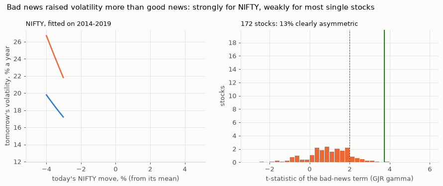

# GARCH Volatility

[](https://github.com/Dhirajdas18/garch-volatility/actions/workflows/ci.yml)
[](https://dhirajdas18.github.io/garch-volatility/)

Volatility forecasting for NSE stocks beyond plain GARCH(1,1): asymmetric models, fat-tailed
shocks, HAR and component models, and forecasts from one day to three months, each tested against
the plain 20-day standard deviation. The findings use a point-in-time universe of the 200
most-traded stocks from a local NSE bhavcopy archive (from 2013), delisted ones included.

**Live GARCH lab: [dhirajdas18.github.io/garch-volatility](https://dhirajdas18.github.io/garch-volatility/)**,
pick a stock, a model and a horizon and see conditional volatility, the forecast to 63 days, the
news-impact curve and one-day value at risk, computed in your browser; refitted every week from
fresh data by GitHub Actions.

## Features

- [x] Asymmetric GARCH (GJR, EGARCH) across 172 stocks, fitted on 2014–2019 and scored on 2020–2026
- [x] Error distributions: normal, Student-t, skewed-t, scored by log-likelihood and VaR breaches
- [ ] Estimation in practice: parameter stability, refit schedules, failed fits
- [ ] HAR on range-based volatility and component GARCH
- [ ] Forecasts from 1 day to 3 months across 200 stocks against the 20-day standard deviation
- [ ] Sizing and volatility targeting with GARCH against the 20-day standard deviation, after costs
- [ ] Market-wide stress and a risk-regime indicator

## Findings

### 1. Bad news raised volatility more than good news; strongly for NIFTY, weakly for single stocks

<a href="docs/img/asymmetry_news.png"><picture><source media="(prefers-reduced-motion: reduce)" srcset="docs/img/asymmetry_news.png"></picture></a>

<a href="docs/img/asymmetry_oos.png"><picture><source media="(prefers-reduced-motion: reduce)" srcset="docs/img/asymmetry_oos.png"></picture></a>

GJR adds a term that only bad days (returns below the mean) feed into tomorrow's variance; EGARCH
models the log of the variance with a separate response to the sign of the shock. Each stock in the
universe's top 200 on 31 December 2019 with returns on 95% of 2014–2019 days (172 stocks) is fitted on
2014–2019 with Student-t shocks, then scored on 2020–2026 with every parameter frozen by the
log-likelihood of each day's return given the variance known the day before (median 1,704 days).
NIFTY is fitted the same way. Archive prices, no dividends.

- **Bad news counted for more in most stocks, but rarely clearly.** GJR's bad-news term was positive
  for 84% of stocks (median 0.040 against a symmetric term of 0.069), but its t-statistic passed 2 for
  only 13%. EGARCH's asymmetry pointed the same way for 81%, past t −2 for 23%.
- **For NIFTY it was almost all bad news.** GJR put NIFTY's symmetric term at 0.000 and its bad-news
  term at 0.140 (t 3.7): a 4% fall lifted tomorrow's volatility to 26.7% a year, a 4% rise left it at 12.6%.
  Refitted on 2020–2026 the bad-news term was 0.125.
- **On unseen years, asymmetry helped a little.** Against plain GARCH, EGARCH scored better for 75% of
  stocks (median +0.0021 log-likelihood a day, t 6.1 across stocks) and GJR for 63% (+0.0004, t 3.0).
  For NIFTY, GJR gained +0.0094 a day while EGARCH lost 0.0053.
- **A stock's own asymmetry barely repeated.** The rank correlation between each stock's GJR bad-news
  term in 2014–2019 and in 2020–2026 was 0.29; in-sample, AIC preferred GJR for 42% of stocks and BIC
  for 14%.
### 2. Every stock had fat tails; Student-t shocks fixed the 1% loss, skew added nothing for stocks

<a href="docs/img/distributions.png"><picture><source media="(prefers-reduced-motion: reduce)" srcset="docs/img/distributions.png"></picture></a>

The same 172 stocks, windows and frozen-parameter scoring as finding 1, with GJR and three shock
distributions: normal, Student-t (fatter tails, with degrees of freedom ν; the lower, the fatter) and
skewed-t (also lopsided, with λ). Each is scored on 2020–2026 by the log-likelihood of each day's return
and by how often the return fell below the model's one-day 1% and 5% value at risk; Kupiec's test asks
whether each stock's breach rate is consistent with the promise.

- **Fat tails everywhere.** Student-t's degrees of freedom had a median of 4.8 (10th–90th percentile
  3.6–6.1); NIFTY's was 7.7. On unseen years Student-t beat the normal for 100% of stocks (median
  +0.064 log-likelihood a day).
- **The normal understated the 1% loss.** Its 1% value at risk was breached on 1.50% of days on average
  (Kupiec rejected 51% of stocks), against 0.97% for Student-t. At 5% it erred the other way (4.07%): a
  normal is too wide in the middle and too thin in the tails.
- **Skew helped NIFTY, not stocks.** Skewed-t matched Student-t for stocks (better for 48%, median
  −0.00001 a day; λ was positive for 90%, a slightly longer right tail). For NIFTY, λ was −0.079 and
  its 1% breach rate fell from 1.82% to 1.58%.
- **The distribution changes the tails, not the volatility.** Student-t and normal fits gave
  volatility paths with a median correlation of 0.982 and the same level (ratio 1.002).
- **Six-year-old parameters were still off for many stocks.** Even with Student-t, Kupiec rejected the
  1% breach rate for 27% of stocks (5% would be expected by chance); finding 3 looks at refitting.

## Quick start

```bash
uv sync
uv run python scripts/fetch_data.py         # Yahoo Finance -> data/prices.parquet
GV_LAKE_DIR=... uv run gv report asymmetry  # also: distributions; needs a local NSE archive
uv run python scripts/build_site.py         # GARCH lab -> site/index.html (fits every model)
uv run pytest
```

Every `gv report` needs a local NSE bhavcopy archive (`GV_LAKE_DIR` with `panel.parquet` and
`universe.parquet`); it is not committed. The lab and the tests run on Yahoo data alone.

## Design

- `src/gv/models.py`: GARCH, GJR and EGARCH fits with Kevin Sheppard's `arch` package (constant
  mean, normal, Student-t or skewed-t shocks); the variance recursions, multi-day forecasts,
  news-impact curves, persistence, half-life and one-day VaR in plain numpy, checked against
  `arch` to 1e-6; Parkinson and Garman-Klass range variances and HAR features.
- `src/gv/garch.js`: the lab's browser copy of the recursions, forecasts and news-impact curves,
  tested against Python through Node to 1e-9.
- `src/gv/data.py`: Yahoo adjusted closes, and adjusted open, high and low, for today's NIFTY
  200, NIFTY and the NIFTY ETF in one (field, symbol) table; known Yahoo errors (unadjusted
  corporate actions, bad prints, stale history) repaired from `docs/data/yahoo_fixes.csv`, each
  with its source; large one-day falls sorted into already fixed, market-wide and isolated.
- `src/gv/universe.py`: the point-in-time universe (each day's 200 most-traded stocks at ₹50 or
  more with a year of history) and the archive's adjusted OHLC, from a local NSE bhavcopy archive
  set by `GV_LAKE_DIR`; only results are committed.
- `src/gv/site.py`: the GARCH lab, one static Plotly page; every stock and model is fitted at
  build time and the page carries the returns and parameters, no price levels.
- `src/gv/asym.py`: the asymmetry study: formation fits, frozen-parameter scoring on later years,
  refits for stability.
- `src/gv/dists.py`: the distribution study (normal, Student-t, skewed-t inside GJR), with VaR
  breaches.
- `src/gv/reports.py`: README findings, reproducible with `gv report <topic>`.
- Conventions: returns are daily log returns in percent; a variance for day t uses returns up to
  t − 1 only, and HAR features for day t use data up to t; volatility is annualised with the
  window's own trading days a year, not a fixed 252. GJR and GARCH forecasts are exact; EGARCH
  forecasts beyond one day are the exp of the expected log variance (no closed form for the
  mean), which understates the mean variance at long horizons.
- Survivorship: the findings use the point-in-time universe, delisted stocks included. The lab
  uses today's NIFTY 200 from Yahoo, and its parameters are fitted on the same five years its
  charts show, so the lab is in-sample and survivorship-biased.
- Charts: one validated palette; README charts are animated GIFs with a static fallback for
  reduced-motion users.

Research only, not investment advice. MIT licence.
